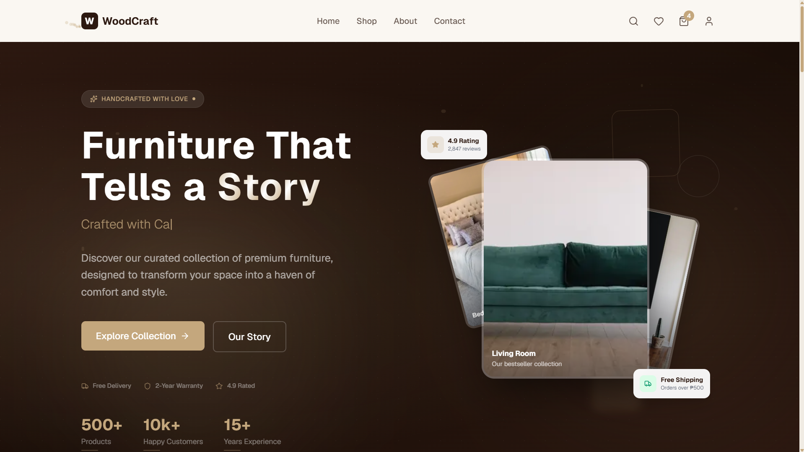
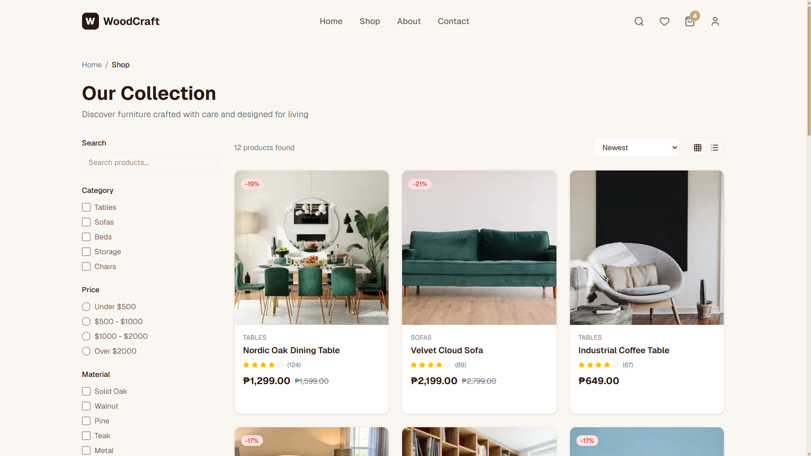
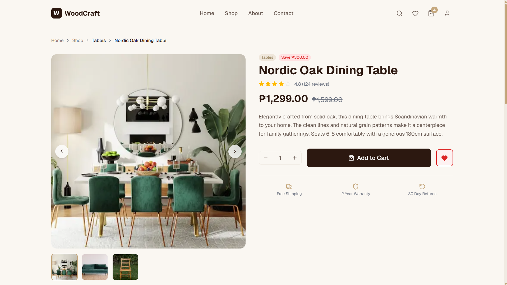
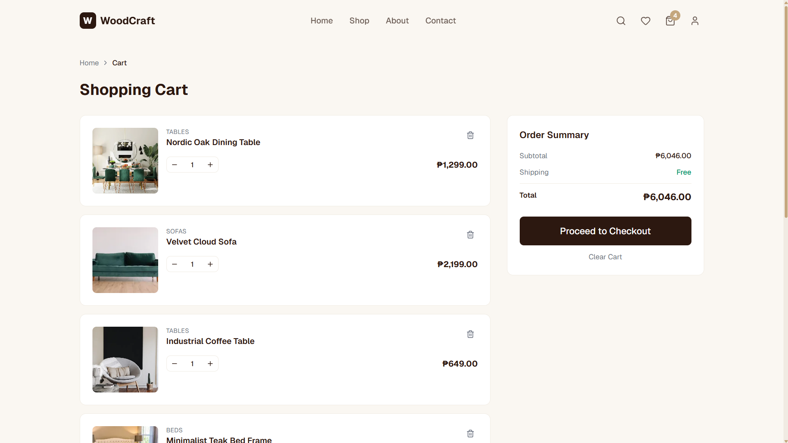
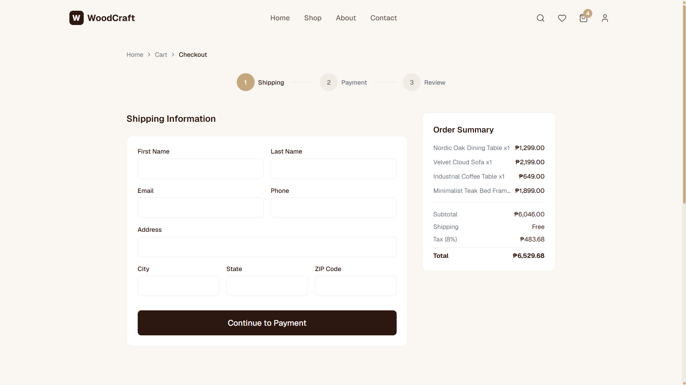
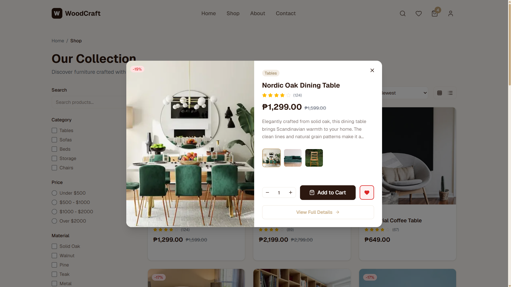

# Amazon Furniture

<p align="center">
  
</p>

<p align="center">
  <a href="https://ecom-furniture-kohl.vercel.app" target="_blank">
    
  </a>
  
  
  
  
  
  
</p>

A premium full-stack furniture e-commerce platform designed to deliver a polished user experience, business-ready backend logic, and production-oriented deployment structure.

## Overview

Amazon Furniture is a modern online furniture store that combines:

- A premium storefront built with Next.js 16 and React 19
- A secure Express backend for APIs, auth, email, and business workflows
- MongoDB integration with resilient local fallback behavior
- Admin-focused commerce features for orders, products, and operational tasks
- Deployment and production setup guides suitable for real-world launch

## Why this project stands out

- Modern UI with premium e-commerce layout and animation
- Responsive storefront for desktop and mobile experience
- Full-stack architecture ready for customization and scaling
- Clean project documentation for local development and deployment
- Enterprise-style setup for invoices, pricing, and operational flows

## Live Demo

- Website: https://ecom-furniture-kohl.vercel.app
- Repository: https://github.com/deepCO123/amazon-furniture

## Features

| Category | Features |
| --- | --- |
| Storefront | Product catalog, category browsing, featured collections, hero sections |
| Shopping Experience | Cart, wishlist, checkout, product details, filters, quick view |
| Admin & Operations | Product management, order tracking, dashboard-ready flows |
| Security | JWT, secure cookies, rate limiting, protected backend endpoints |
| Business Logic | Discounts, invoicing, email notifications, product data workflows |
| Deployment | Docker setup, nginx example config, Cloudflare tunnel options |
| UX | Framer Motion, Anime.js, responsive layouts, polished transitions |

## Stack

| Layer | Technologies |
| --- | --- |
| Frontend | Next.js 16, React 19, TypeScript |
| Backend | Node.js, Express.js |
| Database | MongoDB / MongoDB Atlas |
| Styling | Tailwind CSS |
| State | Zustand |
| Forms | React Hook Form + Zod |
| UI Effects | Framer Motion + Anime.js |
| Icons | Lucide React |
| Email | Nodemailer |

## Screenshots

<p align="center">
  
  
</p>

<p align="center">
  
  
</p>

<p align="center">
  
  
</p>

## Project Structure

```text
amazon-furniture/
├── .github/
├── backend/                  # Express API and server logic
├── ecom-furniture-main/
│   └── ecom-furniture-main/  # Next.js storefront application
├── amazon-logo-pack/         # Brand assets and logo resources
├── image/                    # Project image assets
├── docker-compose.yml        # Container-based setup
├── nginx.conf.example        # Proxy configuration example
├── package.json              # Root scripts and project orchestration
├── RUN_APP.md                # Local startup guide
├── DEPLOYMENT_GUIDE.md        # Deployment notes
├── PRODUCTION_SETUP.md       # Production setup guide
├── PROJECT_TECH_STACK.md     # Platform and architecture overview
├── AMAZON_FURNITURE_FINAL_PRODUCTION_READINESS_REPORT.md
├── start-project.bat         # Windows launcher
├── start-cloudflare.bat      # Cloudflare tunnel helper
├── .gitignore
├── README.md
└── package-lock.json
```

## Quick Start

### Install dependencies

```bash
npm run install:all
```

### Start the full app

```bash
npm run dev
```

This will run both services together:

- Frontend: http://localhost:3000
- Backend: http://localhost:5000

### Alternative commands

```bash
npm run backend
npm run frontend
npm run build
npm run test
```

## Documentation

This repo includes practical documentation for setup and launch:

- [RUN_APP.md](./RUN_APP.md)
- [DEPLOYMENT_GUIDE.md](./DEPLOYMENT_GUIDE.md)
- [PRODUCTION_SETUP.md](./PRODUCTION_SETUP.md)
- [PROJECT_TECH_STACK.md](./PROJECT_TECH_STACK.md)
- [AMAZON_FURNITURE_FINAL_PRODUCTION_READINESS_REPORT.md](./AMAZON_FURNITURE_FINAL_PRODUCTION_READINESS_REPORT.md)

## Environment Notes

For production or custom deployment, review and update these values before launch:

- MongoDB connection string
- JWT secret
- SMTP credentials
- Cloudinary settings
- Allowed CORS origins

## Contributing

1. Fork the repository
2. Create your feature branch
3. Commit clear and focused changes
4. Open a pull request with a concise summary

## License

This project is provided for learning, internal use, and custom deployment work. Please confirm licensing requirements before commercial or public distribution.

---

Built with care for a premium furniture commerce experience.
